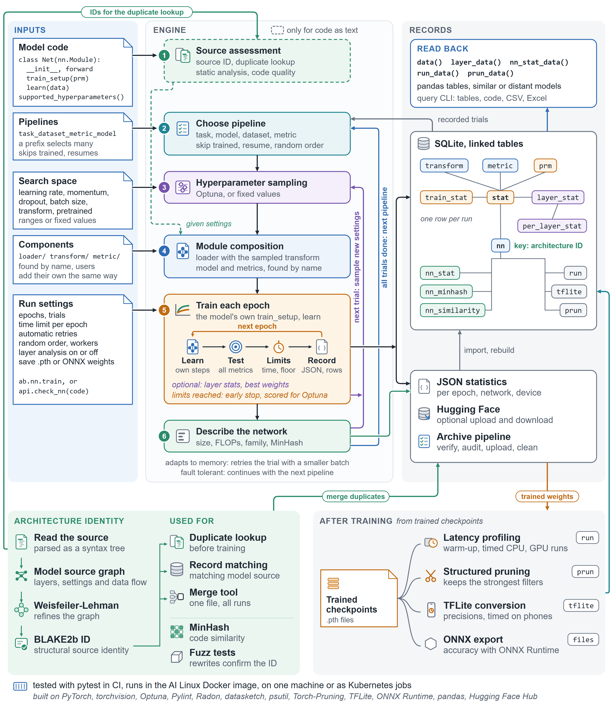

# Summary

The LEMUR framework, distributed on PyPI as `nn-dataset`, is an open-source
Python package for training neural networks and analysing their results under
one shared protocol. Researchers supply model code and choose a task, dataset,
and evaluation measure; the framework trains the model and records its scores,
losses, hardware context, and resource use at every epoch. Further analyses
measure the properties of individual layers and identify each architecture from
its source code, so that results from different studies can be found and
compared in one database. Models, data loaders, transformations, and evaluation
measures are added as single Python files, and models written by researchers or
by code generators are evaluated in the same way. The software is released
under the MIT licence at https://github.com/ABrain-One/nn-dataset
[@nndataset2026].

# Statement of need

Studies of network architectures and training procedures repeat the same
work: each needs training code, a way to store results together with the model
code and settings that produced them, and measurements of losses, gradients,
running time, and layer properties. Results depend on learning procedures,
memory, and hardware, so they are comparable only when these conditions are
recorded consistently [@bouthillier2021variance], and code written separately
for each study is hard to maintain and share [@sculley2015debt].

The LEMUR framework provides this work once: a common model interface that
keeps each model's own learning code, shared training and failure handling,
source-level architecture identity, and a database that keeps every measurement
with its settings. Researchers in deep learning, neural architecture search, and
AutoML can evaluate their own model code without manual intervention, and as
studies grow across models, datasets, and settings, shared records keep
comparisons feasible and completed experiments reusable.

# State of the field

Model libraries such as `timm` [@wightman2019timm] provide implementations and
weights. NAS-Bench-101 [@ying2019nasbench101] and NAS-Bench-201
[@dong2020nasbench201] provide results for defined collections of architectures. 
MLflow [@zaharia2018mlflow] and Weights and Biases [@biewald2020wandb] record
parameters, metrics, and model files. Ray Tune [@liaw2018tune] schedules
user-defined trials and handles failures. Optuna [@akiba2019optuna] searches
hyperparameters. PyTorch Lightning [@falcon2019lightning] manages training loops,
logging, and checkpoints through model methods and callbacks.

Using these tools with researchers' own model code requires extra code for
source comparison, layer measurements, and queries connecting these outputs to
settings. The LEMUR framework supplies these components as one combination: a
model interface that keeps learning code with the model, analysis routines that
work with any model following it, and linked database tables that tie outputs
to settings, while reusing PyTorch and Optuna for execution and search. Keeping measurement and selection code in the package lets different
studies reuse the same procedures while retaining each model's learning method.

# Software design

The LEMUR framework keeps data interfaces, execution, and recording in separate parts, so that each can change without affecting the others. The analysis routines build on this separation to relate each implementation to its learning behaviour and computational cost under recorded conditions. \autoref{fig:overview} shows how the inputs pass through the evaluation engine into the records, and how the architecture identity and the post-training tools connect to them.

**Component interfaces.** Each PyTorch [@paszke2019pytorch] model module contains its own loss, optimizer, learning steps, and hyperparameters, while the engine handles data preparation, evaluation, and recording under a common protocol. Models therefore keep their own training procedures while sharing evaluation and recording. Datasets, transformations, and evaluation measures follow the same convention, each provided as a single Python file that implements its declared interface. The experiment configuration names the task, dataset, metric, and model, and together with the transformation name these selections determine which modules the engine loads dynamically and combines through their interfaces. An image classification experiment, for example, combines AlexNet, CIFAR-10, accuracy, and normalisation. Researchers add a model, data loader, transformation, or metric by writing one file and selecting it by name, and reuse the shared training, evaluation, and recording code unchanged.

**Failure handling and recovery.** Before and during training, the package checks each candidate so that every trial produces a usable record. Static analysis runs first: Pylint [@pylint2024] reports errors, unused variables, and style problems, and Radon [@radon2024] reports the complexity of each function. A quick test then builds the network and trains it on two batches of random images to confirm that initialisation and the first learning steps run. When a batch exceeds GPU memory, the package lowers the maximum batch size and restarts the trial with a smaller batch.

Each trial runs in isolation. When a trial raises an error, the framework reports it and continues the study with the next sampled configuration, and a model's pipeline is set aside only after a configurable number of failed attempts. A long experiment over many models and settings therefore continues past individual failures and completes the remaining pipelines.

**Budget allocation.** Each epoch runs under a time limit that the researcher declares before training, 30 minutes by default, so the cost of every model is fixed in advance and each model receives its share of the available time. For each epoch, an estimator predicts the total duration from the first batches, and the epoch stops between batches when the prediction exceeds the limit. To concentrate compute on promising networks, a network whose accuracy after an epoch is below 1.2 times the random-guess baseline for its dataset stops early.

**Record identity.** Different architectures must stay distinct in the database, and the same architecture written in different ways should be recognised as a single entry. The package therefore gives model code its own fingerprint. It reads the model source as Python syntax, builds a graph of the layers and their settings, ignores variable names and formatting, folds simple arithmetic such as `256 * 6 * 6` into one number, and refines the resulting graph with the Weisfeiler–Lehman procedure [@weisfeiler1968reduction] into a structural certificate stored as a BLAKE2b hash. Computing the identity from a trained model would require building every candidate first, which is the cost that the check is intended to avoid, and a hash of the raw text would treat a renamed or reformatted copy as a new architecture. The certificate is computed from the source structure, so a duplicate is identified before training and renaming or formatting preserves its identity. For architectures with different fingerprints, MinHash signatures [@broder1997syntactic] over the code text measure similarity and retrieve related variants. Values that are not model code, such as hyperparameter sets, receive a plain content hash of their text instead.

**Record structure.** Every run stores the primary metric, the duration, the
batch size, and the learning rate, momentum, dropout, and transformation
settings. Records are written once per epoch rather than once per batch, which keeps the stored data small across many trials while still showing the learning curve. For later analysis,
the record adds the training and test loss, the training accuracy, the
gradient norm after the epoch, samples per second, and the sampled machine
context, which covers processor load, total and occupied memory, and the
graphics device with its memory. Layer analysis stores one row per analysed
layer for selected epochs, including how much the layer contributes to the
loss [@molchanov2017pruning], how much of its representation carries
information [@roy2007effectiverank], how similar its output is to that of
other layers [@kornblith2019cka], how much the loss changes when its weights
and biases are zeroed, the size of its gradients, the fraction of its near-zero outputs, and a statistic of its weight matrix [@martin2021weightwatcher]. 

**Persistent storage.** A database layer holds the stored code, settings,
scores, and layer measurements under the identities described above, so runs
can be found and compared across experiments. The schema is shared across experiments, allowing new runs to reuse the existing tables. Queries return pandas DataFrames
[@mckinney2010pandas], so analysis happens outside the training environment. Each experiment also writes its statistics
as JSON files into its own folder, where they can be read directly, and the
database can be rebuilt from the stored code and these JSON files at any time.

**Post-training tools.** Saved checkpoints feed further analyses. Latency
profiling times CPU and GPU inference after warm-up runs, structured pruning
removes the filters with the lowest L1 norm in each layer, and TFLite conversion
produces models at several precisions that can be timed on phones. The results
of these tools are stored in their own database tables next to the training
records. ONNX export writes model files and checks their accuracy with ONNX
Runtime.

# Research impact statement

The framework was used to build two public collections of trained networks
[@goodarzi2025lemur; @uzun2026lemur2] and provides the evaluation API used by
NNGPT [@kochnev2026nngpt]. Applications include
a study of 25 learning-rate schedules across 30 architectures
[@mateen2026scheduling] and 18 loss-optimizer pairings across 33 architectures
and six datasets [@abramochkin2026lossoptimizer]. Studies of model generation
through code changes [@adhikari2026delta] and extraction of network code from
repositories [@khalid2025nnrag] also used the evaluation procedures.

The package has been downloaded 33,353 times from PyPI as of 16 November 2026,
including automated downloads [@pepy2026downloads]. Since October 2024, the
repository has received 369 pull requests and has 38 contributors. It provides
installation and extension instructions, tagged releases, a changelog, examples,
and automated tests that run on GitHub Actions.

# AI usage disclosure

DeepSeek V4.1 Flash, used through the Kilo Code assistant, supported drafting,
restructuring, and editing of this manuscript, code inspection, and
documentation, and Claude Opus 5.5 helped with editing the manuscript and
checking its claims against the source code. The human authors reviewed, edited, and validated all AI-assisted
output, checked technical claims against the source code, made the core design
and scientific decisions, and remain responsible for accuracy, originality, and
licensing.

# Acknowledgements

Contributions to the LEMUR framework are gratefully acknowledged. Waleed Khalid,
Saif U Din, Sai Revanth Mulukuledu, Akashdeep Singh, Chandini Vysyaraju,
Raghuvir Duvvuri, Avi Goyal, Yashkumar Rajeshbhai Lukhi, Muhammad A. Hussain,
Krunal Jesani, Usha Shrestha, Yash Mittal, Roman Kochnev, Pritam Kadam,
Mohsin Ikram, Harsh Rameshbhai Moradiya, and Alice Arslanian contributed to
the software. The Alexander von
Humboldt Foundation provided partial support.

# References
